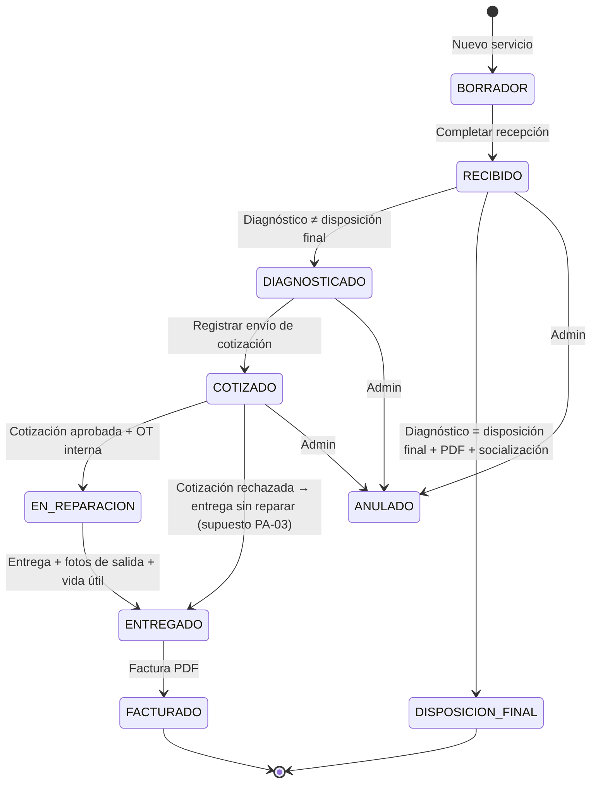

# PRD — Servicio Técnico de Baterías y Cargadores (PWA offline-first)

- **Versión del documento**: 1.0 (diseño)
- **Fecha**: 2026-10-21
- **Dueño del producto**: Álvaro Sotelo
- **Estado**: Aprobado para diseño. Las preguntas abiertas (§12) deben resolverse antes de la fase indicada en cada una.

---

## 1. Resumen

App instalable (PWA) que reemplaza el registro en Excel del ciclo de servicio de **baterías y cargadores** que la empresa recibe de sus clientes (ej.: Navar Asociados, Aris Mining Segovia, Aris Mining Marmato). Permite capturar datos, fotos y PDFs **sin conexión** desde celular, tablet o PC. Cuando hay internet, el usuario confirma su cuenta Microsoft 365 del tenant y los registros se suben a SharePoint, que es la fuente oficial para consulta, reportes y automatizaciones (correos y alertas).

## 2. Problema y contexto

- Hoy el seguimiento se lleva en un Excel con columnas por etapa (`CARACTERES Y OPCIONES PARA CARGADORES Y BATERIAS EN INSTALACIÓN DE EMPRESA (1).xlsx`). Fotos y PDFs se adjuntan a mano ("SUBIR JPG", "SUBIR PDF").
- La recepción y el diagnóstico ocurren en instalaciones del cliente o en el taller, a veces **sin cobertura** (ej. operaciones mineras).
- El nombre del cliente se escribe distinto entre registros ("siempre escribir el mismo"). Esto rompe los reportes.
- No hay alertas automáticas de vida útil ni un aviso por correo cuando se genera la orden de trabajo interna.
- No hay trazabilidad de quién registró qué y cuándo.

## 3. Objetivos y métricas de éxito

| #   | Objetivo                                                       | Métrica                                                        | Meta                            |
| --- | -------------------------------------------------------------- | -------------------------------------------------------------- | ------------------------------- |
| O1  | Capturar sin conexión con la misma fiabilidad que con conexión | Registros perdidos por falta de red                            | 0                               |
| O2  | Datos consistentes                                             | % de registros con cliente tomado del catálogo                 | 100 %                           |
| O3  | Subida oportuna                                                | % de registros sincronizados en menos de 24 h desde su captura | ≥ 95 %                          |
| O4  | Captura ágil                                                   | Tiempo medio de una recepción completa con 3 fotos             | ≤ 3 min                         |
| O5  | Seguimiento proactivo                                          | Alertas de vida útil enviadas antes de la fecha proyectada     | 100 % de los equipos entregados |
| O6  | Sincronización confiable                                       | % de ejecuciones de sincronización sin error                   | ≥ 98 %                          |

## 4. Usuarios y roles

| Rol (app role en Entra ID) | Quién es                     | Qué hace en la app                                                                                                 |
| -------------------------- | ---------------------------- | ------------------------------------------------------------------------------------------------------------------ |
| `Tecnico`                  | Técnico de campo o de taller | Recepción, diagnóstico, disposición final, orden de trabajo, entrega (fotos de salida, vida útil).                 |
| `Comercial`                | Administrativo o comercial   | Cotización, facturación. Consulta todo.                                                                            |
| `Administrador`            | Coordinador del servicio     | Todo lo anterior + corregir etapas cerradas, anular registros, menú técnico avanzado, ver la configuración remota. |

- Un usuario puede tener varios roles.
- El **cliente final no usa la app**. Solo recibe la información que le socializa la empresa (cotización, disposición final).
- Los roles controlan la UI. La autorización real sobre los datos la da SharePoint (ver ADR-0006 y ADR-0018).

## 5. Alcance

### 5.1 Dentro del alcance (MVP v1.0)

1. Instalación como app en Android, iOS/iPadOS, Windows y macOS, con guía de instalación dentro de la app.
2. Asistente de **configuración inicial** (requiere conexión una vez): login, descarga de catálogos y configuración, solicitud de almacenamiento persistente.
3. **Recepción** de batería o cargador con fotos de ingreso (cámara o galería, optimizadas).
4. **Diagnóstico** con formato PDF y observación técnica. Rama de **disposición final**: se socializa al cliente, se carga el PDF y se cierra el registro.
5. **Cotización** (registro de envío al cliente, valor, respuesta y PDF opcional).
6. **Orden de trabajo interna** (detalle de lo necesario y costo de reparación interna). Genera un correo automático (Power Automate).
7. **Entrega** (fecha, fotos de salida, proyección de vida útil).
8. **Facturación** (PDF de factura, número y fecha).
9. Listado y búsqueda local de servicios (por serie, solicitud, cliente o estado) y detalle con línea de tiempo de etapas.
10. **Sincronización** manual (botón) y automática al recuperar la conexión con la app abierta, con confirmación de identidad, progreso, errores, reintentos y resolución de conflictos.
11. **Alertas de vida útil** dentro de la app (vencidas, ≤30, ≤60, ≤90 días) y por correo (Power Automate).
12. Menús: inicio, servicios, sincronización, alertas, ajustes (tamaño de fuente, tema), ayuda/uso, acerca de (versión, novedades), menú técnico (diagnóstico, logs, respaldo) y configuración inicial.
13. Exportar un respaldo ZIP de los registros pendientes, para compartirlo manualmente si la sincronización no es posible.
14. Anulación de registros con motivo (solo Administrador).

### 5.2 Fuera del alcance (v1.0)

- Backend propio, APIs propias, bases de datos fuera de SharePoint.
- Portal o acceso para clientes externos.
- Generar el PDF de la cotización o de la factura dentro de la app (se adjuntan PDFs generados en otros sistemas).
- Integración con el ERP o el sistema de facturación electrónica.
- Notificaciones push.
- Reportes y tableros dentro de la app (se hacen con vistas de SharePoint, exportación a Excel o Power BI).
- Edición de catálogos (clientes, marcas) desde la app. Se administran en SharePoint.
- Multi-idioma (solo es-CO, aunque los textos quedan externalizados).

## 6. Flujo de negocio (resumen)

Detalle de reglas: ADR-0012 y `03-Modelo-de-Datos.md` §5.

## 7. Historias de usuario y criterios de aceptación

**HU-01 — Instalar la app** (Técnico, Comercial, Admin)
Como usuario quiero instalar la app en mi dispositivo para usarla sin conexión.

- CA1: Si la app se abre en una pestaña del navegador sin instalar, se muestra la pantalla "Instala la app" con instrucciones específicas del dispositivo detectado (Android/Chrome, iOS/Safari, Windows/Edge, macOS).
- CA2: En Chrome y Edge hay un botón "Instalar" que usa el aviso nativo del navegador.
- CA3: En iOS no instalado, el formulario queda **bloqueado** (riesgo de borrado de datos). En los demás navegadores se muestra una advertencia y se permite continuar.

**HU-02 — Configuración inicial** (todos)
Como usuario nuevo quiero preparar la app una vez con conexión para luego trabajar sin red.

- CA1: El asistente pide iniciar sesión con la cuenta del tenant y valida que el usuario tenga al menos un rol de la app.
- CA2: Descarga los catálogos (clientes, marcas, valores de diagnóstico y otros Choice) y `ConfiguracionApp`.
- CA3: Solicita almacenamiento persistente y muestra el resultado.
- CA4: Al terminar, la app funciona en modo avión: crear un registro, adjuntar fotos y guardar.

**HU-03 — Registrar recepción sin conexión** (Técnico)
Como técnico quiero registrar la recepción de una batería o un cargador con fotos aunque no tenga internet.

- CA1: Campos obligatorios: tipo de equipo, fecha de recepción (por defecto hoy, no futura), cliente (del catálogo, con autocompletado), marca, referencia (alfanumérica), serie (alfanumérica) y al menos 1 foto de ingreso. El **número de solicitud no se captura**: lo asigna el sistema al sincronizar (PA-07, ADR-0024).
- CA2: Las fotos se pueden tomar con la cámara o elegir de la galería o del disco. Se optimizan a JPEG ≤1920 px y quedan visibles como miniaturas al instante.
- CA3: El borrador se guarda automáticamente. Si se cierra la app, al volver el borrador sigue ahí.
- CA4: Si existe un servicio abierto con la misma serie, se muestra una advertencia (no bloquea).
- CA5: Al "Completar recepción" el estado pasa a `RECIBIDO` y el registro queda **pendiente de sincronizar**.

**HU-04 — Diagnosticar** (Técnico)

- CA1: Se elige el diagnóstico de la lista (valores leídos de SharePoint), se adjunta el formato de diagnóstico en PDF (obligatorio) y se escribe la observación técnica (verbal o escrita, transcrita).
- CA2: Si el diagnóstico es **disposición final**, se piden la fecha de socialización con el cliente y el PDF de disposición final (obligatorios). Al completar, el estado pasa a `DISPOSICION_FINAL` y se omiten las demás etapas.

**HU-05 — Registrar cotización** (Comercial)

- CA1: Se registran la fecha de envío al cliente (obligatoria), el valor (opcional, COP) y un PDF (opcional). El estado de la respuesta inicia en "Pendiente".
- CA2: Al marcar "Aprobada" se habilita la OT. Si se marca "Rechazada", se habilita la entrega sin reparación (supuesto PA-03).

**HU-06 — Orden de trabajo interna** (Técnico)

- CA1: Se registran el detalle de lo necesario para la reparación (repuestos, actividades) y el costo de reparación interna (COP). Ambos son obligatorios.
- CA2: Tras sincronizar, Power Automate envía un correo a la lista configurada (`CorreoDestinoOT`) con los datos de la OT y el enlace al registro.

**HU-07 — Entrega** (Técnico)

- CA1: Fecha de entrega (≥ fecha de recepción), al menos 1 foto de salida y proyección de vida útil (fecha > fecha de entrega; por defecto entrega + `VidaUtilMesesDefecto`, que inicialmente es 12 meses).
- CA2: El estado pasa a `ENTREGADO`.

**HU-08 — Facturación** (Comercial)

- CA1: PDF de factura (obligatorio), número (opcional) y fecha de factura (obligatoria). El estado pasa a `FACTURADO`.

**HU-09 — Sincronizar** (todos)
Como usuario quiero subir mis registros cuando tenga conexión, confirmando mi identidad.

- CA1: El botón "Sincronizar" muestra cuántos registros y archivos están pendientes y la cuenta con que se subirán. El usuario debe pulsar "Confirmar y sincronizar".
- CA2: Si no hay sesión válida o venció la ventana de confirmación (`SyncReautenticacionHoras`), se abre el login de Microsoft.
- CA3: Se muestra el progreso por registro y por archivo. Una interrupción de red no pierde nada y al reintentar continúa donde quedó, sin duplicar.
- CA4: Al finalizar se muestra un resumen: subidos, con error (con mensaje entendible) y en conflicto.
- CA5: Con la app abierta y una sesión válida reciente, al recuperar la conexión se ofrece sincronizar con un aviso. Nunca se sincroniza sin la confirmación de una sesión vigente.

**HU-10 — Ver servicios de otros dispositivos** (todos)

- CA1: Después de sincronizar, la lista incluye los servicios abiertos creados por otros usuarios y los cerrados de los últimos `RetencionCerradosMeses` meses, consultables sin conexión.
- CA2: Las fotos y PDFs remotos se ven como miniatura (si se descargaron) o con un enlace para abrirlos cuando hay conexión.

**HU-11 — Resolver un conflicto** (todos)

- CA1: Si otro usuario modificó en SharePoint el mismo campo que yo modifiqué sin conexión, el registro queda "En conflicto" y la pantalla de detalle muestra, campo por campo, "Mi valor" y "Valor en SharePoint" para elegir.
- CA2: Los campos que no chocan se combinan automáticamente.

**HU-12 — Alertas de vida útil** (Comercial, Admin)

- CA1: La sección Alertas lista los equipos entregados o facturados con proyección vencida, ≤30, ≤60 y ≤90 días, con filtro por cliente.
- CA2: Power Automate envía un correo diario con los equipos que entran en un nuevo umbral (sin repetir el mismo umbral).

**HU-13 — Respaldo manual** (todos)

- CA1: Desde el menú técnico se exporta un ZIP con los registros pendientes y sus archivos, y se puede compartir (Web Share) o descargar.

**HU-14 — Ajustes y ayuda** (todos)

- CA1: Tamaño de fuente (Normal, Grande, Muy grande), guardado en el dispositivo. (Solo tema claro en v1.0, según el estilo de referencia; el tema oscuro queda en el backlog, ADR-0022.)
- CA3: La interfaz sigue el estilo de las pantallas de referencia (`docs/10-Sistema-de-Diseno.md`) y se adapta a celular, tablet y escritorio sin scroll horizontal ni elementos cortados en 360, 768 y 1280 px.
- CA2: Ayuda con guía de uso por etapa, cómo sincronizar y cómo instalar. "Acerca de" muestra la versión, el commit, la fecha de build y las novedades.

**HU-15 — Anular un registro** (Administrador)

- CA1: Se puede anular con un motivo obligatorio en cualquier estado no final. El registro queda de solo lectura y en estado `ANULADO`.

## 8. Requerimientos funcionales

Prioridad según MoSCoW: M = Must, S = Should, C = Could.

| ID    | Requerimiento                                                                                                                              | Prioridad | HU            |
| ----- | ------------------------------------------------------------------------------------------------------------------------------------------ | --------- | ------------- |
| RF-01 | Instalación PWA, detección de modo standalone y guía por plataforma                                                                        | M         | HU-01         |
| RF-02 | Asistente de configuración inicial (login, catálogos, configuración, almacenamiento persistente)                                           | M         | HU-02         |
| RF-03 | CRUD local de servicios con autoguardado de borrador                                                                                       | M         | HU-03         |
| RF-04 | Captura de fotos (cámara, galería, archivos, webcam en escritorio), con compresión y miniaturas                                            | M         | HU-03, HU-07  |
| RF-05 | Adjuntar PDF con validación de tipo y tamaño                                                                                               | M         | HU-04, 05, 08 |
| RF-06 | Validaciones de campos según el Excel (numérico, alfanumérico, fechas, catálogo)                                                           | M         | HU-03…08      |
| RF-07 | Máquina de estados por etapa con permisos por rol                                                                                          | M         | HU-03…08, 15  |
| RF-08 | Rama de disposición final que cierra el registro                                                                                           | M         | HU-04         |
| RF-09 | Login Entra ID (MSAL) con confirmación explícita antes de sincronizar                                                                      | M         | HU-09         |
| RF-10 | Sincronización push idempotente (registros + archivos, upload sessions reanudables)                                                        | M         | HU-09         |
| RF-11 | Sincronización pull incremental de servicios y catálogos                                                                                   | M         | HU-10         |
| RF-12 | Detección y resolución de conflictos por campo                                                                                             | M         | HU-11         |
| RF-13 | Listado, búsqueda y filtros locales; detalle con línea de tiempo                                                                           | M         | HU-10         |
| RF-14 | Alertas de vida útil en la app                                                                                                             | M         | HU-12         |
| RF-15 | Correo de OT y alertas de vida útil por correo (Power Automate)                                                                            | S         | HU-06, HU-12  |
| RF-16 | Indicadores de conexión y de pendientes; recordatorio si hay pendientes de más de 24 h                                                     | M         | HU-09         |
| RF-17 | Menú técnico: almacenamiento, logs, IDs de SharePoint, versión del esquema, forzar actualización, limpiar caché segura                     | M         | —             |
| RF-18 | Exportar respaldo ZIP (Web Share / descarga)                                                                                               | S         | HU-13         |
| RF-19 | Importar respaldo ZIP en otro dispositivo (los registros quedan pendientes)                                                                | C         | HU-13         |
| RF-20 | Ajustes: tamaño de fuente                                                                                                                  | M         | HU-14         |
| RF-30 | Interfaz con el estilo de referencia, mobile-first y adaptable (navegación inferior → riel → barra lateral; lista y detalle en escritorio) | M         | HU-14         |
| RF-21 | Ayuda, Acerca de (versión y novedades)                                                                                                     | M         | HU-14         |
| RF-22 | Aviso de nueva versión y actualización controlada (no interrumpe formularios)                                                              | M         | —             |
| RF-23 | Versión mínima remota (`VersionMinimaApp`): bloquea la sincronización hasta actualizar                                                     | S         | —             |
| RF-24 | Registro de cada sincronización en la lista `LogSincronizacion`                                                                            | S         | —             |
| RF-25 | Anulación con motivo (Admin)                                                                                                               | M         | HU-15         |
| RF-26 | Corrección de etapas cerradas (Admin)                                                                                                      | S         | —             |
| RF-27 | Purga automática segura (archivos originales sincronizados con más de N días, cerrados con más de N meses)                                 | M         | —             |
| RF-28 | Miniaturas remotas descargadas para servicios abiertos (configurable)                                                                      | S         | HU-10         |
| RF-29 | Cambio de usuario en un dispositivo compartido sin perder pendientes                                                                       | S         | —             |

## 9. Requerimientos no funcionales (ISO/IEC 25010)

| ID     | Atributo       | Requerimiento                                                                                                                                                                               |
| ------ | -------------- | ------------------------------------------------------------------------------------------------------------------------------------------------------------------------------------------- |
| RNF-01 | Fiabilidad     | 0 pérdida de datos locales ante cierre de la app, reinicio, pérdida de red a mitad de la subida o actualización de versión.                                                                 |
| RNF-02 | Fiabilidad     | Sincronización idempotente: reintentar N veces produce un solo ítem por servicio y un solo archivo por adjunto.                                                                             |
| RNF-03 | Disponibilidad | 100 % de las funciones de captura y consulta local disponibles sin red. La sincronización depende de M365 (SLA de Microsoft).                                                               |
| RNF-04 | Desempeño      | Arranque de la app instalada sin red: < 2 s en un equipo de gama media. Primera carga con 4G: LCP < 2,5 s.                                                                                  |
| RNF-05 | Desempeño      | Compresión de una foto de 12 MP < 2 s en gama media, sin bloquear la UI (Web Worker).                                                                                                       |
| RNF-06 | Desempeño      | JS inicial ≤ 350 KB gzip. Rutas secundarias con lazy loading.                                                                                                                               |
| RNF-07 | Capacidad      | Soportar al menos 500 servicios y 3 GB de archivos pendientes por dispositivo (sujeto a la cuota del navegador). Aviso al 80 % de la cuota y bloqueo de nuevas fotos al 95 %.               |
| RNF-08 | Usabilidad     | Mobile-first, objetivos táctiles ≥ 44 px, uso con una mano en celular, formularios por pasos.                                                                                               |
| RNF-09 | Accesibilidad  | WCAG 2.2 AA: contraste, teclado, lectores de pantalla, tamaño de fuente escalable.                                                                                                          |
| RNF-10 | Seguridad      | Sin secretos en el cliente. OAuth 2.0 + PKCE. Permisos mínimos (`Sites.Selected`). CSP estricta. HTTPS.                                                                                     |
| RNF-11 | Seguridad      | Trazabilidad: cada registro guarda quién lo capturó (`CapturadoPor`), en qué dispositivo y con qué versión de la app. SharePoint guarda quién lo subió y lo modificó (versionado activado). |
| RNF-12 | Mantenibilidad | TypeScript `strict`. Capas con reglas de ESLint. Cobertura ≥ 90 % en dominio y aplicación, ≥ 70 % global.                                                                                   |
| RNF-13 | Portabilidad   | Chrome/Edge (2 últimas versiones) en Android 10+, Windows 10/11 y macOS 13+. Safari en iOS/iPadOS 17+.                                                                                      |
| RNF-14 | Compatibilidad | Usa solo servicios incluidos en M365 (SharePoint, Entra ID, Power Automate con conectores estándar).                                                                                        |
| RNF-15 | Observabilidad | Log local exportable. Bitácora de sincronización en SharePoint. `client-request-id` en cada llamada a Graph.                                                                                |
| RNF-16 | Actualización  | Una nueva versión llega a cada dispositivo en su siguiente apertura con conexión, sin intervención de un técnico.                                                                           |

## 10. Restricciones y supuestos

- **Restricción**: sin backend. Hosting estático (Cloudflare Pages).
- **Restricción**: dispositivos no administrados (sin Intune). La instalación la hace el usuario.
- **Restricción**: un solo desarrollador, sin CI/CD.
- **Supuesto**: el tenant permite registrar una app SPA con consentimiento de administrador para `Sites.Selected` delegado.
- **Supuesto**: los usuarios tienen licencia M365 con SharePoint y la política de Acceso Condicional no bloquea navegadores en dispositivos no administrados (ver PA-10).
- **Supuesto**: las baterías y los cargadores usan el mismo conjunto de campos (el Excel no los diferencia, ver PA-12).

## 11. Dispositivos y navegadores soportados

| Plataforma                     | Navegador para instalar                      | Soporte                                                          |
| ------------------------------ | -------------------------------------------- | ---------------------------------------------------------------- |
| Android 10+ (celular y tablet) | Chrome (recomendado), Edge, Samsung Internet | Completo                                                         |
| iOS / iPadOS 17+               | Safari ("Agregar a pantalla de inicio")      | Completo, con mitigaciones (sin sincronización en segundo plano) |
| Windows 10/11                  | Edge (recomendado), Chrome                   | Completo                                                         |
| macOS 13+                      | Chrome, Edge, Safari 17+ ("Agregar al Dock") | Completo                                                         |
| Firefox (escritorio)           | —                                            | Solo uso en pestaña, sin instalación (no recomendado)            |

## 12. Preguntas abiertas

Cada pregunta tiene un **valor por defecto** que se implementa si no hay respuesta antes de su fase.

| ID    | Pregunta                                                                                                               | Por defecto (supuesto)                                                                                                                                                                                                                                                                      | Bloquea fase |
| ----- | ---------------------------------------------------------------------------------------------------------------------- | ------------------------------------------------------------------------------------------------------------------------------------------------------------------------------------------------------------------------------------------------------------------------------------------- | ------------ |
| PA-01 | ¿Qué valores tiene la lista de **Diagnóstico**? (el Excel apunta a `V7:V9`, que están vacías; solo aparece "D. FINAL") | Columna Choice editable en SharePoint con: `Reparable`, `Garantía`, `Sin falla`, `D. FINAL` (disposición final). La app lee los valores de SharePoint y trata como disposición final el valor configurado en `DiagnosticoValorDisposicionFinal`                                             | F7           |
| PA-02 | ¿Qué datos lleva la **cotización** además de "se envía al cliente"?                                                    | Fecha de envío (obligatoria), valor COP, estado de la respuesta (Pendiente/Aprobada/Rechazada), PDF opcional                                                                                                                                                                                | F7           |
| PA-03 | ¿Qué pasa si el cliente **rechaza** la cotización?                                                                     | Se permite pasar a Entrega sin OT (devolución sin reparar) y luego a Facturación (p. ej., por el costo del diagnóstico). No hay cierre sin factura en v1.0. Si se requiere, se agrega una transición `ENTREGADO → CERRADO_SIN_FACTURA` mediante un ADR que reemplace al 0012                | F7           |
| PA-04 | ¿Quién recibe el **correo de la OT**?                                                                                  | Una dirección o lista de distribución configurada en `ConfiguracionApp.CorreoDestinoOT`                                                                                                                                                                                                     | F8           |
| PA-05 | ¿Quién recibe las **alertas de vida útil** y con qué umbrales?                                                         | `CorreoDestinoAlertas`, umbrales 90/60/30 días y vencida                                                                                                                                                                                                                                    | F8           |
| PA-06 | ¿Se necesitan **roles** distintos o todos hacen todo?                                                                  | 3 app roles (`Tecnico`, `Comercial`, `Administrador`)                                                                                                                                                                                                                                       | F4           |
| PA-07 | ¿El **número de solicitud** es único? ¿Lo genera otro sistema?                                                         | **Reemplazada por ADR-0024 (2026-11-16)**: es automático. Al sincronizar se lee el mayor número existente en SharePoint y se asigna el siguiente; un número por equipo; mientras tanto el servicio muestra «Pendiente» y el código usa `PEND`. Antes: lo digitaba el usuario y no era único | F3           |
| PA-08 | ¿La **marca** es una lista cerrada?                                                                                    | Texto libre con autocompletado desde la lista `Marcas` y valores ya usados                                                                                                                                                                                                                  | F3           |
| PA-09 | ¿Cuántas **fotos** máximo por etapa?                                                                                   | Ingreso 1–5, salida 1–10 (configurable)                                                                                                                                                                                                                                                     | F3           |
| PA-10 | ¿El tenant tiene **Acceso Condicional** que exija dispositivo administrado o compatible?                               | No exige. Si exige, se necesita una excepción para esta app (lo valida el spike S7)                                                                                                                                                                                                         | F0           |
| PA-11 | ¿Quién es dueño de la **cuenta de Cloudflare** y del dominio? ¿Se usará un dominio propio?                             | Cuenta corporativa a nombre de la empresa. URL `*.pages.dev` en v1.0                                                                                                                                                                                                                        | F0           |
| PA-12 | ¿Baterías y cargadores tienen **campos distintos**?                                                                    | Mismos campos (el Excel no los distingue)                                                                                                                                                                                                                                                   | F3           |
| PA-13 | ¿Se requiere la **observación técnica por audio** ("verbal")?                                                          | No. Se transcribe a texto (el teclado del dispositivo permite dictado)                                                                                                                                                                                                                      | F7           |
| PA-14 | Nombre y URL del **sitio SharePoint** (DEV y PRD)                                                                      | `/sites/ServicioTecnicoBC-DEV` y `/sites/ServicioTecnicoBC`                                                                                                                                                                                                                                 | F4           |

## 13. Riesgos

| ID   | Riesgo                                                               | Prob. | Impacto | Mitigación                                                                                                                       |
| ---- | -------------------------------------------------------------------- | ----- | ------- | -------------------------------------------------------------------------------------------------------------------------------- |
| R-01 | iOS borra los datos de la PWA o la cuota es menor                    | Media | Alto    | Instalación obligatoria en iOS, `storage.persist()`, recordatorio de pendientes, respaldo ZIP, purga de originales sincronizados |
| R-02 | El login por redirect falla en la PWA instalada en alguna plataforma | Baja  | Alto    | Spike S1 en la Fase 0, antes de construir el resto                                                                               |
| R-03 | Acceso Condicional bloquea dispositivos no administrados             | Media | Alto    | Spike S7. Excepción de política acotada a la app                                                                                 |
| R-04 | Throttling de Graph (429) con muchas fotos                           | Baja  | Medio   | Respeto de `Retry-After`, backoff, concurrencia de subida = 2                                                                    |
| R-05 | Conflictos por edición simultánea de la misma etapa                  | Baja  | Medio   | Etapas secuenciales con un responsable, merge por campo, UI de resolución                                                        |
| R-06 | Pérdida o robo del dispositivo con datos sin sincronizar             | Media | Medio   | Recordatorio a las 24 h, sincronización frecuente, bloqueo de pantalla del dispositivo (recomendación)                           |
| R-07 | El consentimiento de `Sites.Selected` no se otorga                   | Baja  | Medio   | Alternativa: `Sites.ReadWrite.All` delegado (ADR-0007)                                                                           |
| R-08 | El desarrollador único es un punto único de falla                    | Media | Medio   | Documentación SDD/ADR completa, CLAUDE.md, código con pruebas                                                                    |

## 14. Glosario

- **PWA**: aplicación web progresiva, instalable y con funcionamiento sin conexión gracias a un service worker.
- **Servicio**: un equipo (batería o cargador) recibido bajo una solicitud, con todo su ciclo hasta el cierre.
- **Sincronizar**: subir los cambios locales a SharePoint y descargar los cambios remotos.
- **Pendiente**: registro o archivo con cambios locales aún no confirmados en SharePoint.
- **Disposición final (D. FINAL)**: el equipo no se repara. Se informa al cliente y se cierra el registro.
- **OT**: orden de trabajo interna.
- **Tenant**: la organización de Microsoft 365 / Entra ID de la empresa.
