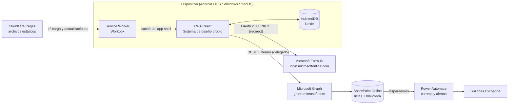
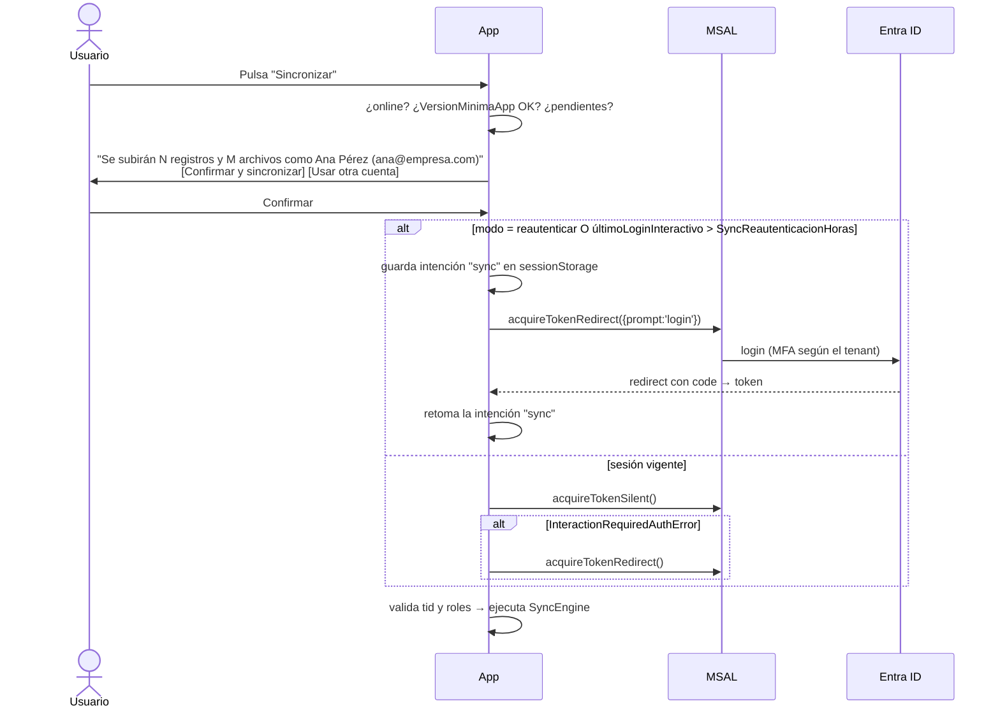
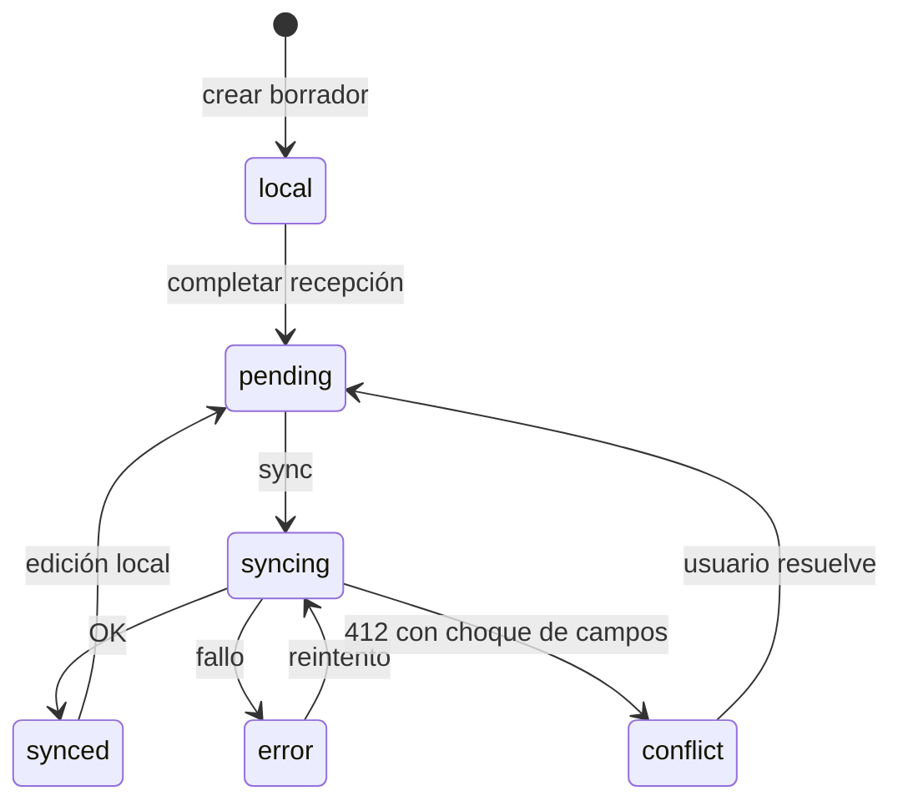

# SDD — Software Design Document

- **Producto**: Servicio Técnico de Baterías y Cargadores (PWA offline-first)
- **Versión**: 1.0 (diseño) · **Fecha**: 2026-10-21
- **Documentos relacionados**: [PRD](01-PRD.md) · [Modelo de datos](03-Modelo-de-Datos.md) · [UX](04-UX-Pantallas-y-Menus.md) · [ADR](adr/README.md)

---

## 1. Introducción

### 1.1 Propósito

Este documento describe **cómo** se construye la app que pide el PRD. Su objetivo es que un agente de IA o un desarrollador implemente el sistema completo sin tomar decisiones de arquitectura por su cuenta.

### 1.2 Alcance técnico

SPA de React instalable como PWA. Persistencia en IndexedDB. Autenticación con Entra ID (MSAL.js). Integración directa con Microsoft Graph (SharePoint Online). Hosting estático en Cloudflare Pages. Automatizaciones de correo en Power Automate (fuera del código de la app).

### 1.3 Convenciones

- Los "**debe**" son obligatorios y los "**debería**" son recomendados.
- Los nombres de dominio están en español (`servicio`, `adjunto`, `estado`). El código técnico genérico puede ir en inglés (`useLiveQuery`, `retryWithBackoff`).
- Las fechas de negocio son `yyyy-MM-dd` (sin hora ni zona). Las marcas de tiempo son ISO-8601 UTC. La zona de visualización es `America/Bogota`.

---

## 2. Vista de contexto



- **No hay servidor propio.** El único código que se ejecuta es el de la PWA en el dispositivo y los flujos de Power Automate en M365.
- La PWA habla **directamente** con Entra ID y con Graph (Graph admite CORS desde el navegador).

---

## 3. Decisiones de arquitectura

Ver el índice completo en [adr/README.md](adr/README.md). Las principales para este documento: 0002 (PWA), 0003 (stack), 0004 (capas), 0005 (estado), 0006 (auth), 0007 (permisos), 0008 (IndexedDB), 0009 (SharePoint), 0010 (sincronización), 0011 (archivos), 0012 (flujo), 0014 (hosting) y 0018 (seguridad local).

---

## 4. Vista lógica

### 4.1 Capas

```
┌──────────────────────────────────────────────────────────────┐
│ features/*  (React: páginas, componentes, hooks de UI)       │
│   ↓ usa                                                      │
│ application/  (casos de uso, orquestación, puertos)          │
│   ↓ usa                                                      │
│ domain/  (entidades, reglas, máquina de estados, validación) │
└──────────────────────────────────────────────────────────────┘
           ↑ implementa los puertos
┌──────────────────────────────────────────────────────────────┐
│ infrastructure/  (Dexie, Graph, MSAL, media, PWA, logging)   │
└──────────────────────────────────────────────────────────────┘
```

Reglas, que se hacen cumplir con `eslint-plugin-boundaries` o `no-restricted-imports`:

- `domain/` no importa nada fuera de `domain/` (salvo `zod` y `date-fns`).
- `application/` importa `domain/` y sus propios puertos (`application/ports/*`). Nunca importa `infrastructure/` ni React.
- `features/` importa `application/`, `domain/` (tipos), `shared/` y los hooks de `infrastructure/db` (`useLiveQuery`) para lectura reactiva.
- `infrastructure/` implementa los puertos. La composición se hace en `src/app/container.ts` (inyección manual de dependencias).

### 4.2 Estructura de carpetas

```
/
├─ docs/                         # esta documentación + adr/
├─ public/
│  ├─ icons/                     # icon-192.png, icon-512.png, maskable-512.png, apple-touch-icon-180.png
│  ├─ _headers                   # cabeceras de Cloudflare Pages (CSP, HSTS…)
│  └─ robots.txt                 # Disallow: /
├─ src/
│  ├─ main.tsx                   # bootstrap: MSAL handleRedirectPromise → render
│  ├─ app/
│  │  ├─ App.tsx
│  │  ├─ router.tsx              # React Router (createBrowserRouter), lazy routes, guards
│  │  ├─ providers.tsx           # MsalProvider, I18nextProvider, RAC I18nProvider (es-CO), ErrorBoundary
│  │  ├─ escalaFuente.ts         # aplica --escala-fuente en <html> según Ajustes
│  │  └─ container.ts            # composición de dependencias (puertos → adaptadores)
│  ├─ domain/
│  │  ├─ servicio.ts             # tipos Servicio, EstadoServicio, TipoEquipo…
│  │  ├─ adjunto.ts
│  │  ├─ estados.ts              # máquina de estados (transiciones, roles, requisitos)
│  │  ├─ validaciones.ts         # esquemas zod por etapa
│  │  ├─ codigo.ts               # generación del código BAT-…/CAR-…
│  │  ├─ merge.ts                # merge a 3 vías por campo
│  │  ├─ alertas.ts              # cálculo de nivel de alerta de vida útil
│  │  └─ config.ts               # tipo ConfigApp + valores por defecto + esquema zod
│  ├─ application/
│  │  ├─ ports/                  # ServicioRepository, AdjuntoRepository, RemoteGateway, AuthPort,
│  │  │                          # ImageProcessor, Clock, IdGenerator, Logger, ConnectivityPort
│  │  ├─ servicios/              # crearBorrador, actualizarCampos, completarEtapa, anular, descartarBorrador
│  │  ├─ adjuntos/               # agregarFoto, agregarPdf, eliminarAdjunto
│  │  ├─ sync/                   # SyncEngine, pushServicio, pullServicios, purgas
│  │  ├─ setup/                  # configuracionInicial, refrescarCatalogos
│  │  └─ respaldo/               # exportarRespaldo, importarRespaldo
│  ├─ infrastructure/
│  │  ├─ db/                     # dexie.ts (esquema y migraciones), repositorios, hooks liveQuery
│  │  ├─ graph/                  # graphClient.ts (fetch, reintentos, timeouts), sharepointGateway.ts,
│  │  │                          # uploads.ts, mappers/ (dominio ↔ fields SP, choices)
│  │  ├─ auth/                   # msalConfig.ts, msalAuthAdapter.ts, mockAuthAdapter.ts (solo tests)
│  │  ├─ media/                  # imageProcessor.ts (browser-image-compression), thumbnails, sha256
│  │  ├─ pwa/                    # registerSW.ts, installPrompt.ts, standalone.ts, storage.ts
│  │  └─ logging/                # logger.ts (anillo en IndexedDB + consola en dev)
│  ├─ features/
│  │  ├─ inicio/  servicios/  adjuntos/  sincronizacion/  alertas/
│  │  ├─ auth/  configuracion/  ajustes/  tecnico/  ayuda/  acerca/  instalacion/
│  ├─ shared/
│  │  ├─ ui/                     # SISTEMA DE DISEÑO (docs/10 §3): tokens.css, global.css, Icon, AppShell,
│  │  │                          # ResponsiveNav, Card, PrimaryButton, TextField, ComboboxField, DateChip,
│  │  │                          # RangeCalendar, AmountInput, Sheet/Dialog, BarList, DonutProgress, StatusBadge…
│  │  ├─ hooks/                  # useOnline, useStorageEstimate, useRoles…
│  │  ├─ i18n.ts
│  │  ├─ format.ts               # fechas, moneda COP
│  │  └─ errors.ts               # AppError y su taxonomía (§13)
│  └─ locales/es-CO/             # common.json, servicios.json, sync.json, ayuda.json…
├─ tests/
│  ├─ e2e/                       # Playwright
│  └─ fixtures/                  # imágenes y PDFs de prueba, respuestas Graph
├─ CHANGELOG.md
├─ CLAUDE.md
├─ README.md
├─ .env.example
├─ index.html
├─ package.json
├─ tsconfig.json
├─ vite.config.ts
├─ vitest.config.ts
├─ playwright.config.ts
└─ eslint.config.js
```

### 4.3 Puertos (interfaces de `application/ports`)

```ts
export interface ServicioRepository {
  obtener(id: string): Promise<Servicio | undefined>;
  guardar(s: Servicio): Promise<void>; // upsert local (transacción)
  listarPendientes(): Promise<Servicio[]>; // syncState in ('pending','error') && estado !== 'BORRADOR'
  buscarPorSpItemId(itemId: string): Promise<Servicio | undefined>;
  buscarPorSerie(serie: string): Promise<Servicio[]>; // detección de duplicados (spec 003)
  eliminarBorrador(id: string): Promise<void>; // solo estado BORRADOR
  purgarCerrados(antesDe: string): Promise<number>; // nunca toca syncState !== 'synced'
}
export interface AdjuntoRepository {
  obtener(id: string): Promise<Adjunto | undefined>;
  listarPorServicio(servicioId: string): Promise<Adjunto[]>;
  buscarPorHash(
    servicioId: string,
    tipo: TipoAdjunto,
    sha256: string
  ): Promise<Adjunto | undefined>;
  guardar(a: Adjunto): Promise<void>;
  eliminarLocal(id: string): Promise<void>;
  eliminarPorServicio(servicioId: string): Promise<number>;
  marcarPendientes(servicioId: string): Promise<number>; // al completar una etapa
  purgarOriginales(sincronizadosAntesDe: string): Promise<number>;
}
export interface AuthPort {
  cuentaActiva(): CuentaUsuario | null; // de caché, funciona sin red
  rolesCacheados(): readonly Rol[];
  asegurarToken(opts: {
    interactivoSiEsNecesario: boolean;
    forzarLogin?: boolean;
  }): Promise<string>;
  cambiarCuenta(): Promise<void>;
  cerrarSesion(): Promise<void>;
}
export interface MetaRepository {
  obtener<T>(clave: string): Promise<T | undefined>;
  guardar(clave: string, valor: unknown): Promise<void>;
  dispositivoId(): Promise<string>; // se crea una vez y se reutiliza
}
export interface CatalogoRepository {
  obtener<T>(clave: string): Promise<T | undefined>;
  guardar(clave: string, valor: unknown): Promise<void>;
}
export interface UnidadDeTrabajo {
  ejecutar<T>(
    fn: (repos: { servicios: ServicioRepository; adjuntos: AdjuntoRepository }) => Promise<T>
  ): Promise<T>;
}
export interface Clock {
  ahoraIso(): string;
  fechaHoyIso(): string; // fecha local del dispositivo
}
export interface IdGenerator {
  siguiente(): string; // UUID v4 generado en el dispositivo
}
export interface Logger {
  debug(evento: string, datos?: Record<string, unknown>, ctx?: ContextoLog): void;
  info(evento: string, datos?: Record<string, unknown>, ctx?: ContextoLog): void;
  warn(evento: string, datos?: Record<string, unknown>, ctx?: ContextoLog): void;
  error(evento: string, datos?: Record<string, unknown>, ctx?: ContextoLog): void;
}
export interface RemoteGateway {
  // SharePoint vía Graph
  resolverSitio(): Promise<SitioResuelto>;
  leerCatalogos(): Promise<Catalogos>;
  leerConfiguracion(): Promise<Record<string, string>>;
  buscarServicioPorId(id: string): Promise<RemoteServicio | null>;
  crearServicio(campos: CamposSP): Promise<RemoteServicio>;
  actualizarServicio(itemId: string, campos: CamposSP, eTag: string): Promise<RemoteServicio>; // lanza ConflictoError en 412
  subirArchivo(a: Adjunto, ruta: string, onProgreso: (n: number) => void): Promise<RemoteArchivo>;
  actualizarMetadatosArchivo(driveItemId: string, campos: Record<string, unknown>): Promise<void>;
  eliminarArchivo(driveItemId: string): Promise<void>;
  listarArchivosServicio(servicioId: string, anio: string): Promise<RemoteArchivo[]>;
  descargarMiniatura(driveItemId: string): Promise<Blob>;
  cambiosServicios(deltaLink?: string): AsyncGenerator<RemoteCambio, { deltaLink: string }>;
  registrarLogSync(entrada: LogSyncEntrada): Promise<void>;
}
export interface ImageProcessor {
  optimizar(file: File | Blob, opts: { maxLado: number; calidad: number }): Promise<Blob>;
  miniatura(blob: Blob, lado: 320): Promise<Blob>;
}
```

Puertos adicionales que definen las specs (firmas exactas en cada `plan.md`):

- `StoragePort` (spec 003): estimación de la cuota.
- `MetaRepository` (spec 002/005): lectura y escritura de la tabla `meta` (IDs de SharePoint, deltaLink, `metodoPull`, `ultimoCorrelationId`, `ultimaSyncEn`, …).
- `IntencionSyncPort` (spec 005): guarda y recupera la intención de sincronizar a través del redirect de login (en `sessionStorage`).
- Puntos de extensión del `SyncEngine` (spec 005/006): la fase pull y la resolución de conflictos se enchufan al motor que construye la 005.

---

## 5. Modelo de dominio

Diccionario completo en [03-Modelo-de-Datos.md](03-Modelo-de-Datos.md). Tipos base:

```ts
export type TipoEquipo = 'BATERIA' | 'CARGADOR';
export type EstadoServicio =
  | 'BORRADOR'
  | 'RECIBIDO'
  | 'DIAGNOSTICADO'
  | 'COTIZADO'
  | 'EN_REPARACION'
  | 'ENTREGADO'
  | 'FACTURADO'
  | 'DISPOSICION_FINAL'
  | 'ANULADO';
export type EstadoCotizacion = 'PENDIENTE' | 'APROBADA' | 'RECHAZADA';
export type TipoAdjunto =
  | 'FOTO_INGRESO'
  | 'FORMATO_DIAGNOSTICO'
  | 'DISPOSICION_FINAL'
  | 'COTIZACION'
  | 'FOTO_SALIDA'
  | 'FACTURA';
export type SyncState = 'local' | 'pending' | 'syncing' | 'synced' | 'error' | 'conflict';
export type Rol = 'Tecnico' | 'Comercial' | 'Administrador';

/** Campos de negocio que se sincronizan (claves = nombres de dominio). */
export interface CamposServicio {
  tipoEquipo: TipoEquipo;
  estado: EstadoServicio;
  fechaRecepcion: string;
  clienteId: number;
  clienteNombre: string;
  numeroSolicitud: number;
  marca: string;
  referencia: string;
  serie: string;
  diagnostico?: string;
  observacionTecnica?: string;
  fechaSocializacionDF?: string;
  cotizacionFechaEnvio?: string;
  cotizacionValor?: number;
  cotizacionEstado?: EstadoCotizacion;
  otDetalle?: string;
  otCostoReparacion?: number;
  fechaEntrega?: string;
  proyeccionVidaUtil?: string;
  facturaNumero?: string;
  facturaFecha?: string;
  anulacionMotivo?: string;
  anulacionFecha?: string;
}

export interface Servicio extends CamposServicio {
  id: string; // UUID v4 (= ServicioId)
  codigo: string;
  capturadoPor: string;
  capturadoPorNombre: string;
  creadoEn: string;
  actualizadoEn: string;
  dispositivoId: string;
  // --- sincronización ---
  syncState: SyncState;
  camposSucios: (keyof CamposServicio)[]; // modificados localmente desde el último push
  base: Partial<CamposServicio>; // valores del servidor en el último sync (para el merge)
  conflictos: { campo: keyof CamposServicio; local: unknown; remoto: unknown }[];
  sp?: { itemId: string; eTag: string; modificadoEn: string; webUrl: string; urlCarpeta?: string };
  intentos: number;
  proximoIntentoEn?: string;
  ultimoError?: { codigo: string; mensaje: string; en: string };
  origen: 'local' | 'remoto'; // remoto = descargado, creado en otro dispositivo
}
```

### 5.1 Máquina de estados (`domain/estados.ts`)

Implementarla como **tabla de datos**, no con `if` dispersos:

```ts
interface Transicion {
  desde: EstadoServicio;
  hacia: EstadoServicio;
  accion: string;
  roles: Rol[];
  requisitos: (s: Servicio, adj: Adjunto[], cfg: ConfigApp) => ErrorValidacion[];
}
export const TRANSICIONES: Transicion[] = [/* ver 03-Modelo-de-Datos §5 */];
export function transicionesDisponibles(
  s,
  roles,
  adj,
  cfg
): { t: Transicion; errores: ErrorValidacion[] }[];
export function aplicarTransicion(s, hacia, roles, adj, cfg, ahora): Servicio; // lanza si no es válida
export function camposEditables(s: Servicio, roles: Rol[]): Set<keyof CamposServicio>;
```

- `aplicarTransicion` cambia `estado`, agrega `estado` (y los campos de la etapa) a `camposSucios` y pone `syncState = 'pending'`.
- `BORRADOR → RECIBIDO` es la primera vez que el registro es sincronizable.
- Cobertura de pruebas del 100 % sobre la tabla de transiciones (cada transición: válida, faltan requisitos, rol incorrecto).

### 5.2 Validación (`domain/validaciones.ts`)

- Esquemas **zod** por etapa (`esquemaRecepcion`, `esquemaDiagnostico`, …) que reutilizan `react-hook-form` (`zodResolver`) y `aplicarTransicion` (misma fuente de verdad).
- Los mensajes de error son **claves i18n** (`errores.serie.formato`), no texto.
- Las normalizaciones (mayúsculas, trim) se aplican con `.transform()` en el esquema y en el `onBlur` del campo.

---

## 6. Persistencia local (IndexedDB con Dexie)

### 6.1 Esquema

```ts
// src/infrastructure/db/dexie.ts
export class AppDB extends Dexie {
  servicios!: Table<Servicio, string>;
  adjuntos!: Table<Adjunto, string>;
  catalogos!: Table<{ clave: string; valor: unknown; actualizadoEn: string }, string>;
  meta!: Table<{ clave: string; valor: unknown }, string>;
  logs!: Table<EntradaLog, number>;

  constructor() {
    super('servicio-tecnico-bc');
    this.version(1).stores({
      servicios:
        'id, estado, syncState, serie, numeroSolicitud, clienteId, fechaRecepcion, proyeccionVidaUtil, actualizadoEn, sp.itemId',
      adjuntos: 'id, servicioId, [servicioId+tipo], syncState',
      catalogos: 'clave',
      meta: 'clave',
      logs: '++seq, ts, nivel',
    });
  }
}
```

### 6.2 Reglas

- **Transacciones**: cualquier operación que toque un servicio y sus adjuntos usa `db.transaction('rw', db.servicios, db.adjuntos, …)`.
- **Migraciones**: solo se suben versiones (`this.version(2).stores(...).upgrade(...)`). Un `upgrade` **nunca** elimina registros no sincronizados. Cada migración tiene una prueba con `fake-indexeddb` que parte de datos de la versión anterior.
- **Blobs**: los archivos se guardan como `Blob` dentro del registro `adjuntos` (IndexedDB los soporta en todos los navegadores objetivo). No se usa OPFS en v1.0.
- **Almacenamiento persistente**: `navigator.storage.persist()` en la configuración inicial y al arrancar si aún no está concedido. Resultado guardado en `meta`.
- **Cuota**: `navigator.storage.estimate()` al iniciar y antes de cada captura. Advertencia ≥ 80 % y bloqueo de nuevas fotos o PDFs ≥ 95 % (RNF-07).
- **Purgas** (`application/sync/purgas.ts`), después de un sync exitoso:
  - Originales (`adjunto.blob`) con `syncState='synced'` y sincronizados hace más de `RetencionOriginalesDias` → `blob = null` (se conserva la miniatura).
  - Servicios en estado final, `syncState='synced'` y `actualizadoEn` mayor a `RetencionCerradosMeses` → se eliminan con sus adjuntos locales.
  - Las purgas tienen pruebas que verifican que **nunca** borran algo con `syncState !== 'synced'` (es decir, nunca `local`, `pending`, `syncing`, `error` ni `conflict`).

---

## 7. Integración con SharePoint (Microsoft Graph v1.0)

### 7.1 Cliente HTTP (`infrastructure/graph/graphClient.ts`)

- `fetch` con wrapper propio, sin SDK. Mantiene el bundle pequeño y el control total de reintentos.
- Cabeceras en cada llamada: `Authorization: Bearer <token>`, `client-request-id: <uuid>` (se guarda en el log para trazabilidad con Microsoft) y `Accept: application/json`.
- **Timeouts** con `AbortController`: 10 s para metadatos (guía base §4.10), 60 s por PUT de archivo o fragmento.
- **Reintentos**: ver §9.6.
- Base URL: `https://graph.microsoft.com/v1.0`.

### 7.2 Resolución de IDs (configuración inicial, se guardan en `meta`)

| Operación              | Endpoint                                                                                                                                                                      |
| ---------------------- | ----------------------------------------------------------------------------------------------------------------------------------------------------------------------------- |
| Sitio                  | `GET /sites/{VITE_SP_HOSTNAME}:{VITE_SP_SITE_PATH}?$select=id,webUrl`                                                                                                         |
| Listas                 | `GET /sites/{siteId}/lists?$select=id,name,displayName` → mapear por `name` (`Servicios`, `Clientes`, `Marcas`, `ConfiguracionApp`, `LogSincronizacion`, `ServiciosAdjuntos`) |
| Drive de la biblioteca | `GET /sites/{siteId}/lists/{libId}/drive?$select=id`                                                                                                                          |

### 7.3 Operaciones

| Uso                         | Método y endpoint                                                                                                                                                                           | Notas                                                                                           |
| --------------------------- | ------------------------------------------------------------------------------------------------------------------------------------------------------------------------------------------- | ----------------------------------------------------------------------------------------------- |
| Columnas Choice (catálogos) | `GET /sites/{siteId}/lists/{servId}/columns?$select=name,choice`                                                                                                                            | Extrae `Diagnostico`, `Estado`, `CotizacionEstado`, `TipoEquipo`                                |
| Clientes / Marcas / Config  | `GET /sites/{siteId}/lists/{id}/items?$expand=fields($select=Title,Activo,Valor)&$top=999`                                                                                                  | Seguir `@odata.nextLink`                                                                        |
| Buscar servicio por id      | `GET /sites/{siteId}/lists/{servId}/items?$filter=fields/ServicioId eq '{id}'&$expand=fields`                                                                                               | `ServicioId` indexado                                                                           |
| Crear servicio              | `POST /sites/{siteId}/lists/{servId}/items` `{ "fields": { … } }`                                                                                                                           | Si responde un conflicto de valor único, se busca por id (idempotencia)                         |
| Actualizar servicio         | `PATCH /sites/{siteId}/lists/{servId}/items/{itemId}/fields` + `If-Match: {eTag}`                                                                                                           | Solo `camposSucios`. 412 → conflicto (§9.5). **Validar en el spike S3**                         |
| Cambios remotos             | `GET /sites/{siteId}/lists/{servId}/items/delta?$expand=fields` → seguir `@odata.nextLink`, guardar `@odata.deltaLink`                                                                      | **Validar en el spike S4**. Respaldo: §9.4                                                      |
| Subida simple (≤ 4 MB)      | `PUT /drives/{driveId}/root:/{ruta}:/content?@microsoft.graph.conflictBehavior=replace`                                                                                                     | Fotos optimizadas ~200–600 KB                                                                   |
| Subida grande (> 4 MB)      | `POST /drives/{driveId}/root:/{ruta}:/createUploadSession` `{ "item": { "@microsoft.graph.conflictBehavior": "replace" } }` → `PUT` de fragmentos de 3 200 KiB (10 × 320 KiB) a `uploadUrl` | La `uploadUrl` **no** lleva `Authorization`. Se guarda en `adjunto.uploadSession` para reanudar |
| Metadatos del archivo       | `PATCH /drives/{driveId}/items/{itemId}/listItem/fields` `{ ServicioId, AdjuntoId, TipoAdjunto, FechaCaptura, CapturadoPor }`                                                               | —                                                                                               |
| Listar adjuntos remotos     | `GET /drives/{driveId}/root:/{anio}/{servicioId}:/children?$expand=listItem($expand=fields($select=AdjuntoId,TipoAdjunto,FechaCaptura))&$select=id,name,size,webUrl,file,eTag`              | 404 = sin adjuntos                                                                              |
| Miniatura                   | `GET /drives/{driveId}/items/{itemId}/thumbnails/0/medium/content`                                                                                                                          | Solo si `DescargarMiniaturasRemotas`                                                            |
| Abrir original              | `webUrl` en una pestaña nueva (requiere conexión y sesión del navegador)                                                                                                                    | —                                                                                               |
| Eliminar archivo            | `DELETE /drives/{driveId}/items/{itemId}`                                                                                                                                                   | Solo adjuntos con `eliminarRemoto`                                                              |
| Log de sync                 | `POST /sites/{siteId}/lists/{logId}/items`                                                                                                                                                  | Fallo silencioso (solo log local)                                                               |

### 7.4 Mapeo dominio ↔ SharePoint (`infrastructure/graph/mappers/`)

- `aCamposSP(servicio, camposSucios)` produce solo las columnas sucias, con conversiones:
  - Choice ↔ código (§4 del modelo de datos).
  - `clienteId` → `ClienteLookupId` (número).
  - Fechas `yyyy-MM-dd` → `yyyy-MM-ddT00:00:00Z` para columnas de solo fecha. Al leer, se toman los primeros 10 caracteres. **Validar en S3** cómo devuelve SharePoint las fechas de solo fecha según la zona del sitio. La zona del sitio debe ser `(UTC-05:00) Bogota`.
  - Moneda y número → `number`.
  - Siempre se envían `AppVersion`, `ActualizadoEnDispositivo` y `DispositivoId`.
  - **Nunca** se envían `OTCorreoEnviado` ni `AlertaVidaUtilNivel`.
- `deCamposSP(fields)` produce `Partial<CamposServicio>` y los metadatos `sp`.
- El mapper tiene pruebas de ida y vuelta (`deCamposSP(aCamposSP(x)) ≈ x`).

---

## 8. Autenticación y autorización

### 8.1 Configuración MSAL (`infrastructure/auth/msalConfig.ts`)

```ts
export const msalConfig: Configuration = {
  auth: {
    clientId: env.VITE_ENTRA_CLIENT_ID,
    authority: `https://login.microsoftonline.com/${env.VITE_ENTRA_TENANT_ID}`,
    redirectUri: `${window.location.origin}/`,
    postLogoutRedirectUri: `${window.location.origin}/`,
    navigateToLoginRequestUrl: true,
  },
  cache: { cacheLocation: 'localStorage' }, // ADR-0018: necesario para conservar la sesión entre aperturas de la PWA
  system: { loggerOptions: { piiLoggingEnabled: false } },
};
export const SCOPES_GRAPH = ['User.Read', 'https://graph.microsoft.com/Sites.Selected'];
export const SCOPES_LOGIN = ['openid', 'profile', 'offline_access', ...SCOPES_GRAPH];
```

- Librerías: `@azure/msal-browser` + `@azure/msal-react` (última versión estable).
- Interacción **solo por redirect** (`loginRedirect` / `acquireTokenRedirect`). Los popups fallan en iOS standalone.
- `main.tsx` debe esperar a `msalInstance.initialize()` y `handleRedirectPromise()` antes de renderizar.

### 8.2 Primer uso (configuración inicial, con conexión)

1. `loginRedirect({ scopes: SCOPES_LOGIN, prompt: 'select_account' })`.
2. Al volver: validar que `idTokenClaims.tid === VITE_ENTRA_TENANT_ID` y que `idTokenClaims.roles` contenga al menos un rol válido. Si no, mostrar "Tu cuenta no tiene acceso a esta app" y cerrar sesión.
3. Guardar en `meta`: `ultimoLoginInteractivoEn` y `cuentaHomeId`.
4. Resolver los IDs de SharePoint, descargar catálogos y configuración, solicitar `storage.persist()` y marcar `configuracionInicialCompleta = true`.

### 8.3 Uso sin conexión

- `AuthPort.cuentaActiva()` lee la cuenta desde el caché de MSAL (`getActiveAccount()` / `getAllAccounts()`), sin red.
- Los roles se toman de `idTokenClaims` cacheados. Si el caché se perdió pero hay datos locales, se permite capturar con el último usuario guardado en `meta.ultimaCuenta` y se exige login al sincronizar.
- Capturar datos **nunca** requiere red ni token.

### 8.4 Confirmación al sincronizar (RF-09)



- La pantalla de confirmación **siempre** aparece. No hay sincronización silenciosa sin un toque del usuario (cumple "el usuario debe confirmar el login").
- En la configuración por defecto (`confirmar`, 12 h), si el último login interactivo fue hace menos de 12 h basta con el toque de confirmación.
- **Usar otra cuenta**: `loginRedirect({ prompt: 'select_account' })`. Los registros pendientes se suben con la nueva cuenta. `CapturadoPor` conserva a quien capturó (RF-29).

### 8.5 Autorización en la app

- `useRoles()` devuelve los roles del token cacheado. Las acciones de la máquina de estados filtran por rol (§5.1).
- Las rutas y botones no permitidos se ocultan. Si alguien navega directo a una ruta no permitida, ve un mensaje "Sin permiso".
- **Limitación aceptada** (ADR-0018): SharePoint aplica permisos por lista, no por etapa. Un usuario con _Colaborar_ podría editar desde el navegador web de SharePoint. El versionado de SharePoint deja la trazabilidad.

### 8.6 Modo de autenticación simulada (solo pruebas)

- `VITE_AUTH_MODE=mock` usa `mockAuthAdapter` (cuenta y roles fijos, token falso) para Playwright y para desarrollar sin tenant.
- `vite.config.ts` **debe** abortar el build si `mode === 'production'` y `VITE_AUTH_MODE === 'mock'`.

---

## 9. Motor de sincronización (`application/sync/SyncEngine.ts`)

### 9.1 Principios

1. **Sincronización por estado, no por log de operaciones**: cada servicio lleva `camposSucios` y cada adjunto su `syncState`. Así varios cambios al mismo campo se combinan en uno solo y el push es simple de reanudar.
2. **Orden**: push y luego pull. Primero se sube lo local, después se baja lo remoto.
3. **Exclusión mutua**: `navigator.locks.request('sync', { ifAvailable: true }, …)` evita dos sincronizaciones simultáneas, incluso entre pestañas.
4. **Idempotencia**: `ServicioId` único + búsqueda previa + nombres de archivo deterministas con `replace`.
5. **Progreso observable**: el motor emite eventos (`inicio`, `servicio:inicio`, `archivo:progreso`, `servicio:ok`, `servicio:error`, `conflicto`, `fin`) que la UI consume desde un store de Zustand.
6. **Cancelable**: el usuario puede cancelar. Se aborta con `AbortController` y lo terminado queda guardado.

### 9.2 Algoritmo

```
sincronizar(correlationId):
  precondiciones: online, token válido, config.VersionMinimaApp <= versión, configuración inicial completa
  refrescar ConfiguracionApp y catálogos (si fallan, se continúa con el caché)
  # ---------- PUSH ----------
  para cada s en listarPendientes() ordenado por actualizadoEn asc (respetando proximoIntentoEn):
    marcar s.syncState = 'syncing'
    try:
      # 1. Asegurar el ítem remoto (idempotente)
      si !s.sp.itemId:
        remoto = buscarServicioPorId(s.id)
        si !remoto: remoto = crearServicio(aCamposSP(s, TODOS_LOS_CAMPOS))
        s.sp = remoto.meta; s.base = deCamposSP(remoto.fields); s.camposSucios = []
      # 2. Adjuntos
      para cada a en adjuntos(s) con eliminarRemoto: eliminarArchivo(a.sp.driveItemId) → borrar local
      para cada a en adjuntos(s) con syncState in (pending, error)  [concurrencia 2]:
        r = subirArchivo(a, ruta(s, a))        # simple o upload session reanudable
        actualizarMetadatosArchivo(r.id, {...})
        a.sp = r; a.syncState = 'synced'; a.sincronizadoEn = ahora
      # 3. Campos sucios
      si s.camposSucios no está vacío:
        r = actualizarServicio(s.sp.itemId, aCamposSP(s, s.camposSucios + UrlCarpetaAdjuntos), s.sp.eTag)
        s.base = merge(s.base, camposEnviados); s.sp.eTag = r.eTag; s.camposSucios = []
      s.syncState = 'synced'; s.intentos = 0; s.ultimoError = undefined
    catch ConflictoError (412):
      remoto = obtener por itemId → mergeTresVias(s, remoto)   # §9.5
      si quedan conflictos: s.syncState = 'conflict'; si no: reintentar el paso 3 una vez
    catch error reintentable: s.intentos++; s.proximoIntentoEn = backoff(s.intentos); s.syncState = 'error'
    catch error no reintentable: s.syncState = 'error'; s.ultimoError = {...}   # requiere acción
    catch AuthError: abortar todo el sync y pedir login
    catch RedSinConexion: abortar todo el sync (lo pendiente queda pendiente)
    guardar s (transacción con sus adjuntos)
  # ---------- PULL ----------
  para cada cambio en cambiosServicios(meta.deltaLinkServicios):
    si cambio.eliminado: si local.syncState == 'synced' → borrar local; si no → marcar conflicto
    local = buscarPorSpItemId(cambio.itemId) ?? obtener(cambio.fields.ServicioId)
    si !local: insertar como origen='remoto', syncState='synced', base = remoto
    si local.camposSucios vacío: sobrescribir campos con remoto; base = remoto
    si no: mergeTresVias(local, remoto)
  guardar deltaLink
  si DescargarMiniaturasRemotas: para los servicios abiertos con adjuntos remotos sin miniatura → descargar (máx. 50 por sync)
  # ---------- POST ----------
  purgas (§6.2)
  registrarLogSync(...)   # best-effort
  meta.ultimaSyncEn = ahora
```

### 9.3 Estados de sincronización por servicio



### 9.4 Pull incremental: respaldo si `delta` no sirve (spike S4)

Si `items/delta` no devuelve `fields` o no está disponible:
`GET /sites/{siteId}/lists/{servId}/items?$expand=fields&$filter=fields/Modified ge '{ultimaSyncEn - 5 min}'&$top=200` con la cabecera `Prefer: HonorNonIndexedQueriesWarningMayFailRandomly` (con `Modified` indexado). Las eliminaciones no se detectan con este método. Como en v1.0 no se eliminan ítems (se anulan), es aceptable. El método elegido se registra en un ADR nuevo si difiere.

### 9.5 Merge a 3 vías por campo (`domain/merge.ts`)

Para cada campo `f` de `CamposServicio`:

| ¿Sucio local? | `remoto[f] == base[f]`     | `local[f] == remoto[f]` | Resultado                                                 |
| ------------- | -------------------------- | ----------------------- | --------------------------------------------------------- |
| No            | —                          | —                       | Toma `remoto[f]`                                          |
| Sí            | Sí (el servidor no cambió) | —                       | Mantiene `local[f]` (se subirá)                           |
| Sí            | No                         | Sí                      | Ya coinciden: se quita de los campos sucios               |
| Sí            | No                         | No                      | **Conflicto** → `conflictos.push({campo, local, remoto})` |

- `estado` tiene una regla especial: si ambos lo cambiaron, gana el estado **más avanzado** en el orden del flujo, y si el resultado no es coherente con los campos, se marca conflicto.
- Al terminar, `base = remoto` y `sp.eTag = remoto.eTag`.
- La UI de conflictos (`features/sincronizacion/ResolverConflicto.tsx`) muestra cada campo con "Mío" y "SharePoint". Al resolver: el valor elegido queda local; si se eligió "Mío", el campo sigue sucio; `syncState = 'pending'`.
- Pruebas: tabla de casos exhaustiva en `merge.test.ts`.

### 9.6 Reintentos y errores HTTP

| Situación                                                                                                                              | Clasificación   | Acción                                                          |
| -------------------------------------------------------------------------------------------------------------------------------------- | --------------- | --------------------------------------------------------------- |
| `fetch` falla (TypeError) o `navigator.onLine=false`                                                                                   | Red             | Abortar el sync completo. Sin penalizar el contador de intentos |
| Timeout                                                                                                                                | Reintentable    | Backoff                                                         |
| 401                                                                                                                                    | Auth            | `acquireTokenSilent` una vez; si falla, abortar y pedir login   |
| 403                                                                                                                                    | No reintentable | Mensaje "Tu cuenta no tiene permiso en el sitio de SharePoint"  |
| 404 (lista o sitio)                                                                                                                    | Configuración   | Mensaje para soporte + log. Abortar el sync                     |
| Conflicto de valor único en `ServicioId` (409, o 400/500 con un mensaje de valor duplicado; el código exacto se valida en el spike S3) | Idempotencia    | Buscar por id y continuar                                       |
| 412                                                                                                                                    | Conflicto       | §9.5                                                            |
| 413 / archivo demasiado grande                                                                                                         | No reintentable | Marcar el adjunto con error                                     |
| 429, 503, 504                                                                                                                          | Reintentable    | Respetar `Retry-After`; si no viene, backoff                    |
| 5xx (otros)                                                                                                                            | Reintentable    | Backoff                                                         |
| Upload session expirada (404 en `uploadUrl`)                                                                                           | Reintentable    | Descartar la sesión y crear una nueva                           |

**Backoff**: dentro de una ejecución, hasta 4 reintentos por llamada con espera `min(30 s, 1 s × 2^n) + jitter(0–500 ms)`. Entre ejecuciones, `proximoIntentoEn = ahora + min(1 h, 1 min × 2^intentos)`. Con `intentos ≥ 8` deja de reintentarse solo y requiere "Reintentar" manual.

### 9.7 Disparadores de sincronización

- Botón "Sincronizar" (siempre).
- Evento `online` o arranque de la app con conexión: si hay pendientes y una sesión vigente (dentro de `SyncReautenticacionHoras`), se muestra un **aviso** "Tienes N pendientes. ¿Sincronizar ahora?". No se dispara solo.
- Recordatorio en Inicio si hay pendientes con más de `RecordatorioPendientesHoras`.
- **No** se usa Background Sync API en v1.0. No está en iOS y exigiría token sin confirmación del usuario.

---

## 10. Archivos e imágenes

### 10.1 Captura

| Origen                        | Implementación                                                                                                                                                             |
| ----------------------------- | -------------------------------------------------------------------------------------------------------------------------------------------------------------------------- |
| Cámara (móvil o tablet)       | `<input type="file" accept="image/*" capture="environment">` (máxima compatibilidad)                                                                                       |
| Galería o disco               | `<input type="file" accept="image/jpeg,image/png,image/heic,image/heif,image/webp" multiple>`                                                                              |
| Webcam (escritorio, opcional) | Componente con `getUserMedia({ video: { facingMode: 'environment' } })` + `canvas.toBlob`. Solo se muestra si `mediaDevices` está disponible y el dispositivo no es táctil |
| PDF                           | `<input type="file" accept="application/pdf">`. Se valida el tipo (MIME + firma `%PDF-` en los primeros bytes) y `MaxTamanoPdfMB`                                          |

### 10.2 Procesamiento de fotos (`infrastructure/media/imageProcessor.ts`)

- Librería `browser-image-compression` con `useWebWorker: true`, `maxWidthOrHeight: ImagenMaxLadoPx (1920)`, `initialQuality: ImagenCalidad (0.75)`, `fileType: 'image/jpeg'`. Aplica la orientación EXIF y descarta el resto de los metadatos (incluido el GPS: privacidad).
- HEIC (iPhone): Safari ya entrega JPEG al usar `capture`. Si llega un HEIC que el navegador no puede decodificar, se muestra el error "Formato no soportado, toma la foto con la cámara de la app" (no se agrega un decodificador HEIC pesado en v1.0).
- Miniatura de 320 px (JPEG 0.7) generada al capturar, para la galería y la lista.
- `sha256` con `crypto.subtle.digest` para evitar duplicados en la misma etapa.
- Procesamiento **secuencial** si se eligen varias fotos, con progreso visible. Así se evita agotar la memoria en equipos de gama baja.

### 10.3 Visualización

- Miniaturas con `URL.createObjectURL(blob)` y `revokeObjectURL` al desmontar.
- Visor a pantalla completa con zoom (pinch) para fotos locales. Los PDF locales se abren en una pestaña nueva con un object URL (visor nativo del navegador).
- Adjuntos remotos sin blob: miniatura si existe, más el botón "Abrir en SharePoint" (`webUrl`) si hay conexión.

---

## 11. PWA

### 11.1 Manifest (generado por `vite-plugin-pwa`)

```ts
manifest: {
  name: 'Servicio Técnico Baterías y Cargadores',
  short_name: 'ServicioTec',
  description: 'Registro offline del ciclo de servicio de baterías y cargadores',
  lang: 'es-CO',
  start_url: '/',
  scope: '/',
  display: 'standalone',
  orientation: 'any',
  background_color: '#ffffff',
  theme_color: '#0f6cbd',
  icons: [
    { src: '/icons/icon-192.png', sizes: '192x192', type: 'image/png' },
    { src: '/icons/icon-512.png', sizes: '512x512', type: 'image/png' },
    { src: '/icons/maskable-512.png', sizes: '512x512', type: 'image/png', purpose: 'maskable' },
  ],
}
```

Además, en `index.html`: `<link rel="apple-touch-icon" href="/icons/apple-touch-icon-180.png">` y `<meta name="apple-mobile-web-app-capable" content="yes">`.

### 11.2 Service worker (Workbox vía `vite-plugin-pwa`, estrategia `generateSW`)

- `registerType: 'prompt'`: la app decide cuándo aplicar la actualización (§11.4).
- **Precaché** de todo el app shell (`**/*.{js,css,html,svg,png,woff2,json}`).
- `navigateFallback: '/index.html'`.
- **Sin caché en tiempo de ejecución para Graph ni login** (`login.microsoftonline.com`, `graph.microsoft.com`, `*.sharepoint.com`): siempre van por red. Los datos offline viven en IndexedDB, no en la caché del SW.
- `cleanupOutdatedCaches: true`.

### 11.3 Instalación (`infrastructure/pwa/`)

- `standalone.ts`: `matchMedia('(display-mode: standalone)').matches || navigator.standalone === true`.
- `installPrompt.ts`: captura `beforeinstallprompt` (Chrome/Edge) y lo expone a la pantalla Instalar.
- Detección de plataforma por `navigator.userAgentData` con respaldo en `userAgent`, solo para elegir las instrucciones.
- **Puerta de instalación** (`InstallGate`): en iOS/iPadOS sin standalone, bloquea la app y muestra las instrucciones. En las demás plataformas muestra un banner descartable.

### 11.4 Actualización de la app

1. El SW detecta una nueva versión → `onNeedRefresh` → toast "Hay una nueva versión" [Actualizar].
2. Si hay un formulario con cambios sin guardar o un sync en curso, el botón espera ("Se actualizará al terminar").
3. `updateSW(true)` recarga. Dexie aplica las migraciones al abrir.
4. Se comprueban actualizaciones al arrancar y cada 60 min con la app abierta (`registration.update()`).
5. `VersionMinimaApp` (remota): si la versión local es menor, se bloquea la sincronización con el mensaje "Actualiza la app para sincronizar" y un botón que fuerza la búsqueda de actualización.

---

## 12. Interfaz de usuario

Detalle en [04-UX-Pantallas-y-Menus.md](04-UX-Pantallas-y-Menus.md).

- **Sistema de diseño propio** (ADR-0022, [10-Sistema-de-Diseno.md](10-Sistema-de-Diseno.md)): tokens CSS de las pantallas de referencia (ajustados a AA), componentes en `src/shared/ui` con **CSS Modules** sobre **React Aria Components**, Montserrat (`@fontsource/montserrat`) e íconos Material Symbols Rounded en SVG (`@material-symbols/svg-500` + `vite-plugin-svgr`). Mobile-first con breakpoints compacto / medio / expandido (`docs/10` §4).
- **Router**: React Router (`createBrowserRouter`), rutas con lazy loading. Guards: `SetupGuard` (configuración inicial completa), `InstallGate`, `RoleGuard`.
- **Formularios**: `react-hook-form` + `@hookform/resolvers/zod`. Autoguardado con debounce de 800 ms a Dexie (`actualizarCampos`). Estados visibles: guardando, guardado y error.
- **Listas largas**: `@tanstack/react-virtual`.
- **Tema y fuente**: solo tema claro (v1.0). Escala de tipografía (1.0, 1.15, 1.3) aplicada con `--escala-fuente` sobre el `font-size` raíz (todo en `rem`).
- **i18n**: `i18next` + `react-i18next`, idioma `es-CO`, namespaces por feature. Fechas con `date-fns` (locale `es`) y moneda con `Intl.NumberFormat('es-CO', { style: 'currency', currency: 'COP', maximumFractionDigits: 0 })`.
- **Error boundaries** por ruta, con pantalla de recuperación ("Volver al inicio", "Exportar respaldo").

---

## 13. Manejo de errores

```ts
export type CodigoError =
  | 'RED_SIN_CONEXION'
  | 'AUTH_REQUERIDA'
  | 'AUTH_SIN_ROL'
  | 'AUTH_TENANT_INVALIDO'
  | 'SP_SIN_PERMISO'
  | 'SP_NO_ENCONTRADO'
  | 'SP_CONFLICTO'
  | 'SP_LIMITE'
  | 'SP_SERVIDOR'
  | 'VALIDACION'
  | 'ALMACENAMIENTO_LLENO'
  | 'ARCHIVO_INVALIDO'
  | 'VERSION_OBSOLETA'
  | 'DESCONOCIDO';
export class AppError extends Error {
  constructor(
    public codigo: CodigoError,
    public reintentable: boolean,
    public detalle?: unknown,
    public correlationId?: string
  ) {
    super(codigo);
  }
}
```

- Todo error de infraestructura se traduce a `AppError` en el adaptador.
- La UI muestra un mensaje i18n por código (`errores.codigo.SP_SIN_PERMISO`). **Nunca** muestra stack traces ni respuestas crudas de Graph.
- El detalle técnico va al log local junto con `correlationId` y `client-request-id`.
- `window.onerror` y `unhandledrejection` → logger.

---

## 14. Seguridad

### 14.1 Amenazas y controles

| Amenaza                               | Control                                                                                                                                                |
| ------------------------------------- | ------------------------------------------------------------------------------------------------------------------------------------------------------ |
| Robo de credenciales de la app        | No existen: cliente público con PKCE. Solo `clientId` y `tenantId` (no secretos)                                                                       |
| Token robado vía XSS                  | CSP estricta, sin HTML dinámico, sin scripts de terceros, dependencias auditadas (`npm audit`), React escapa por defecto                               |
| Usuario sin autorización              | App role obligatorio + _Assignment required_ en la Enterprise App + permisos del sitio                                                                 |
| Acceso más amplio del necesario       | `Sites.Selected`: solo el sitio concedido                                                                                                              |
| Dispositivo perdido con datos         | Recomendación de bloqueo de pantalla. Datos de negocio de bajo riesgo (ADR-0018). Pendientes visibles y recordatorios                                  |
| Manipulación de datos fuera de la app | Versionado de SharePoint + `CapturadoPor`/`DispositivoId` + bitácora de sync                                                                           |
| Clickjacking                          | `frame-ancestors 'none'`                                                                                                                               |
| Archivos maliciosos                   | Solo JPEG re-codificado (la compresión regenera la imagen) y PDF validado por firma. No se ejecuta ni renderiza contenido de archivos dentro de la app |

### 14.2 `public/_headers` (Cloudflare Pages)

```
/*
  Content-Security-Policy: default-src 'self'; script-src 'self'; style-src 'self'; font-src 'self'; img-src 'self' blob: data: https://*.sharepoint.com https://*.svc.ms; connect-src 'self' https://login.microsoftonline.com https://graph.microsoft.com https://*.sharepoint.com; frame-src https://login.microsoftonline.com; worker-src 'self' blob:; manifest-src 'self'; base-uri 'self'; form-action 'self' https://login.microsoftonline.com; frame-ancestors 'none'; object-src 'none'
  Strict-Transport-Security: max-age=31536000; includeSubDomains
  X-Content-Type-Options: nosniff
  Referrer-Policy: strict-origin-when-cross-origin
  Permissions-Policy: camera=(self), microphone=(), geolocation=()
  Cross-Origin-Opener-Policy: same-origin-allow-popups
/sw.js
  Cache-Control: no-cache
/index.html
  Cache-Control: no-cache
```

- `style-src 'self'` **sin** `unsafe-inline`: con CSS Modules el CSS se extrae a archivos estáticos en el build. Los atributos `style={…}` de React se aplican vía CSSOM y la CSP no los bloquea. Si alguna librería (React Aria, MSAL) inyectara un `<style>`, se detecta en el spike S8 y se decide (hash/nonce o `unsafe-inline` con un ADR). Las fuentes se sirven desde el mismo origen (`font-src 'self'`).
- `frame-src` para login es necesario porque MSAL usa un iframe oculto para renovar tokens en silencio.
- `worker-src blob:` es necesario para el Web Worker de `browser-image-compression`. Si en el spike S8 la librería no carga su worker por CDN, se configura `libURL` local. **Prohibido** cargar scripts desde un CDN externo.

### 14.3 Dependencias

- `npm audit --omit=dev` sin vulnerabilidades altas ni críticas antes de cada release.
- Dependabot o Renovate opcional (si el repositorio está en GitHub, con alertas activadas aunque no haya CI/CD).

---

## 15. Observabilidad

- **Logger local** (`infrastructure/logging/logger.ts`): niveles `debug|info|warn|error`. Escribe en la tabla `logs` (anillo de 2000 entradas, se borran las más antiguas) y en la consola en desarrollo. Campos: `ts`, `nivel`, `evento`, `mensaje`, `datos` (sin tokens ni blobs), `correlationId`, `clientRequestId`, `appVersion`.
- **Eventos mínimos**: arranque (versión, plataforma, standalone, cuota), login/logout, inicio y fin de sync con totales, cada error de Graph (método, ruta sin query, estado, `client-request-id`), migraciones de DB, purgas, actualización del SW.
- **Bitácora remota**: un ítem en `LogSincronizacion` por ejecución (§7.3).
- **Menú técnico**: ver los logs filtrados, exportarlos (incluidos en el respaldo ZIP) y copiar el `correlationId` del último sync.
- **Sin servicios externos de telemetría en v1.0** (Sentry y Application Insights quedan descartados por ahora, ADR-0017).

---

## 16. Configuración y ambientes

### 16.1 Variables de build (`.env.example`)

```dotenv
# Entra ID (públicos, NO son secretos)
VITE_ENTRA_TENANT_ID=00000000-0000-0000-0000-000000000000
VITE_ENTRA_CLIENT_ID=00000000-0000-0000-0000-000000000000
# SharePoint
VITE_SP_HOSTNAME=empresa.sharepoint.com
VITE_SP_SITE_PATH=/sites/ServicioTecnicoBC-DEV
# Ambiente
VITE_APP_ENV=dev            # dev | prd
VITE_AUTH_MODE=msal         # msal | mock (mock prohibido en build de producción)
```

- Archivos: `.env.development` (DEV), `.env.production` (PRD), `.env.test` (mock). Ninguno contiene secretos. Aun así, solo se versiona `.env.example`.
- Se validan con zod al arrancar (`src/shared/env.ts`). Si falta una variable, se muestra una pantalla de error de configuración.
- `__APP_VERSION__`, `__GIT_COMMIT__` y `__BUILD_DATE__` se inyectan con `define` en `vite.config.ts`.

### 16.2 Ambientes

| Ambiente      | URL                                                      | Sitio SharePoint               | App Registration |
| ------------- | -------------------------------------------------------- | ------------------------------ | ---------------- |
| Local         | `http://localhost:5173`                                  | DEV                            | DEV              |
| DEV (preview) | `https://dev.<proyecto>.pages.dev`                       | `/sites/ServicioTecnicoBC-DEV` | DEV              |
| PRD           | `https://<proyecto>.pages.dev` (o dominio propio, PA-11) | `/sites/ServicioTecnicoBC`     | PRD              |

### 16.3 Configuración remota

`ConfiguracionApp` (modelo de datos §6.3) se lee en cada sync y en la configuración inicial. El objeto `ConfigApp` final es `defaults ⊕ remoto válido`.

---

## 17. Rendimiento

- Presupuesto: JS inicial ≤ 350 KB gzip (verificado con `rollup-plugin-visualizer` antes de cada release).
- Lazy loading para: detalle de servicio, sincronización, alertas, menú técnico, ayuda y el visor de imágenes.
- Las consultas Dexie usan índices. La búsqueda por texto (serie, código, cliente) recorre en memoria la colección filtrada por estado (volumen < 5 000).
- Las imágenes se procesan en un Web Worker, una a la vez.
- Lighthouse (móvil) ≥ 90 en Performance, Accessibility y Best Practices.

---

## 18. Estrategia de pruebas

Detalle en [08-Plan-de-Pruebas.md](08-Plan-de-Pruebas.md). Resumen:

- **Unitarias** (Vitest): dominio (estados, validaciones, merge, alertas, código), mappers, backoff, purgas.
- **Integración** (Vitest + `fake-indexeddb` + MSW): repositorios Dexie, SyncEngine contra un Graph simulado (éxito, 412, 429, red caída a mitad, upload session reanudada).
- **Componentes** (Testing Library): formularios por etapa, galería, pantalla de sync.
- **E2E** (Playwright, auth mock + Graph interceptado): flujo completo offline → online, en Chromium y WebKit con viewport móvil.
- **Manual en dispositivos reales**: matriz del plan de pruebas (instalación, cámara, login redirect, persistencia).

---

## 19. Despliegue

Detalle en [09-Despliegue-Operacion-y-Soporte.md](09-Despliegue-Operacion-y-Soporte.md). Resumen: `npm run verify && npm run build && npx wrangler pages deploy dist --project-name <proyecto> --branch main`, hecho a mano por el desarrollador después de etiquetar la versión (`vX.Y.Z`).

---

## 20. Trazabilidad requerimiento → diseño

| RF                  | Diseño (sección) | Módulos principales                                            |
| ------------------- | ---------------- | -------------------------------------------------------------- |
| RF-01               | §11.3            | `infrastructure/pwa`, `features/instalacion`                   |
| RF-02               | §8.2, §7.2       | `application/setup`, `features/configuracion`                  |
| RF-03, RF-06, RF-07 | §5, §6, §12      | `domain/*`, `application/servicios`, `features/servicios`      |
| RF-04, RF-05        | §10              | `infrastructure/media`, `features/adjuntos`                    |
| RF-08               | §5.1             | `domain/estados.ts`                                            |
| RF-09               | §8.4             | `infrastructure/auth`, `features/sincronizacion`               |
| RF-10, RF-11        | §9.2, §7.3       | `application/sync`, `infrastructure/graph`                     |
| RF-12               | §9.5             | `domain/merge.ts`, `features/sincronizacion/ResolverConflicto` |
| RF-13               | §12, §17         | `features/servicios`                                           |
| RF-14               | §12              | `domain/alertas.ts`, `features/alertas`                        |
| RF-15               | ADR-0013         | Power Automate (fuera del código)                              |
| RF-16, RF-22, RF-23 | §9.7, §11.4      | `features/inicio`, `infrastructure/pwa`                        |
| RF-17, RF-18, RF-19 | §15, §6.2        | `features/tecnico`, `application/respaldo`                     |
| RF-20, RF-21        | §12              | `features/ajustes`, `features/ayuda`, `features/acerca`        |
| RF-24               | §7.3, §15        | `infrastructure/graph`, `application/sync`                     |
| RF-25, RF-26        | §5.1             | `domain/estados.ts`                                            |
| RF-27               | §6.2             | `application/sync/purgas.ts`                                   |
| RF-28               | §9.2, §10.3      | `application/sync`, `infrastructure/graph`                     |
| RF-29               | §8.4             | `features/sincronizacion`, `infrastructure/auth`               |
